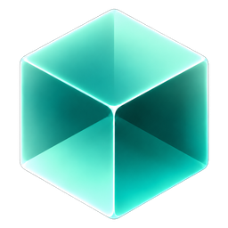
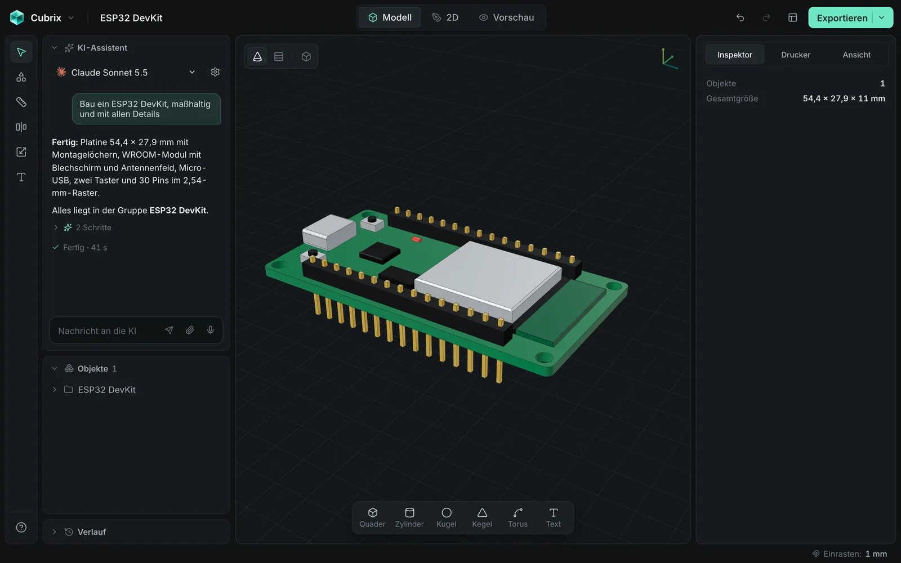
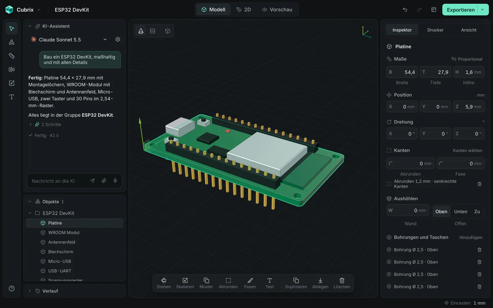
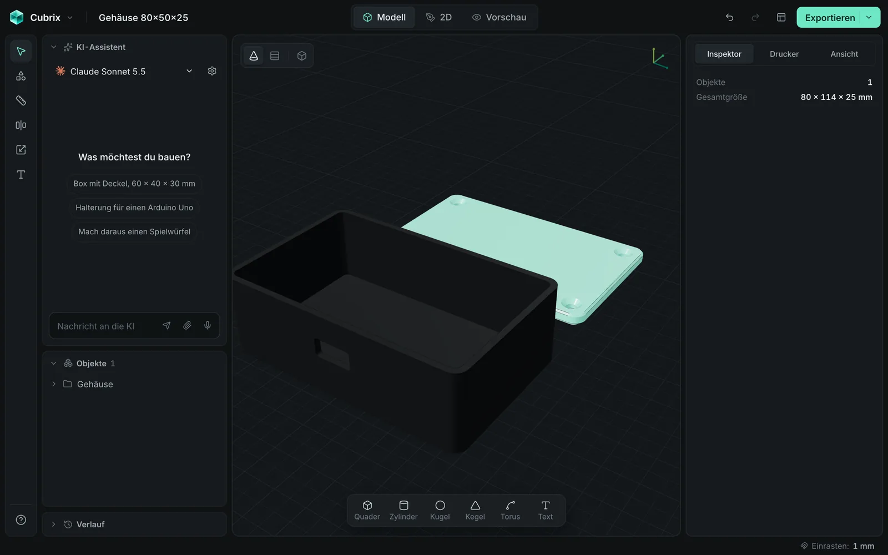
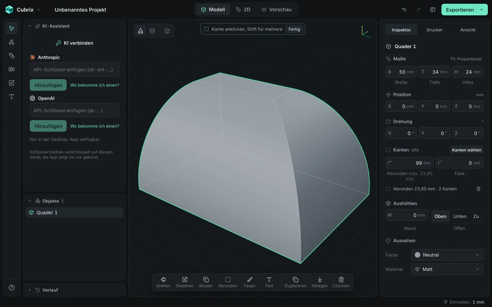
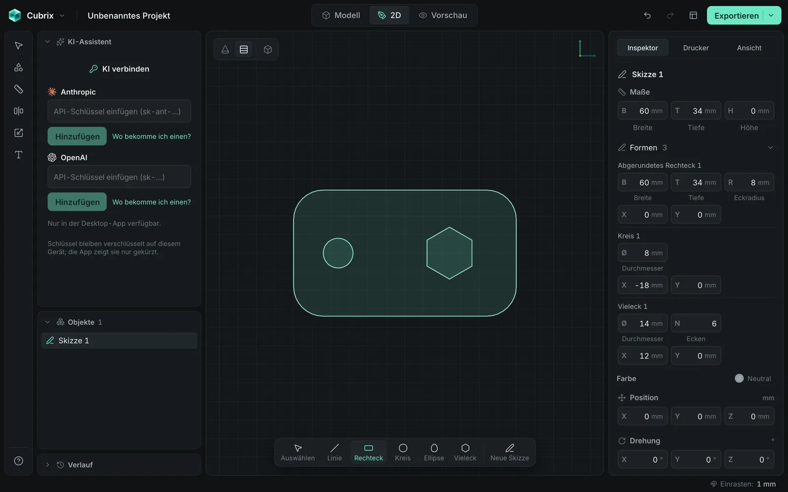
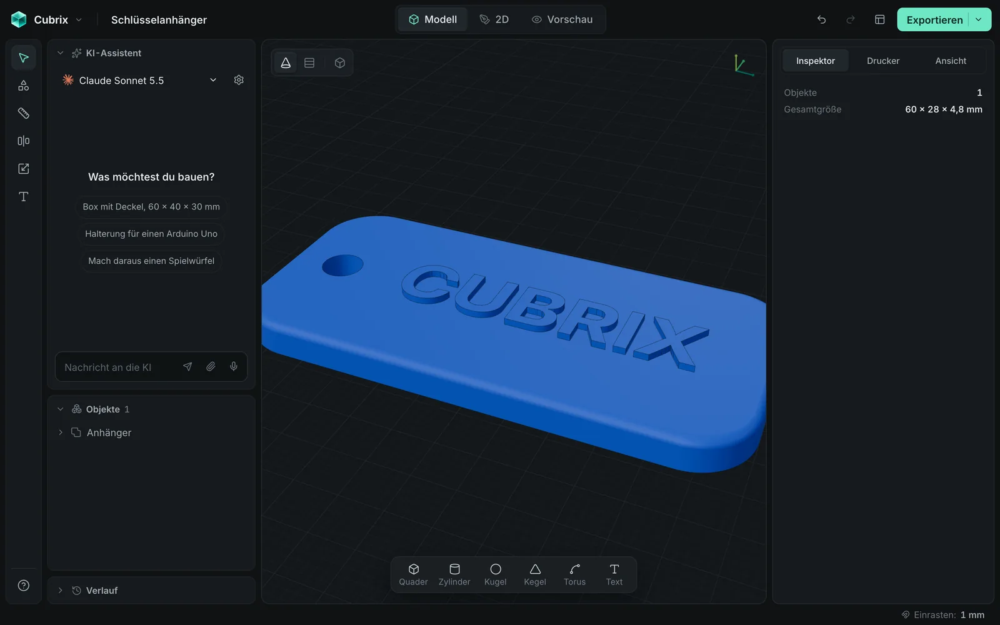
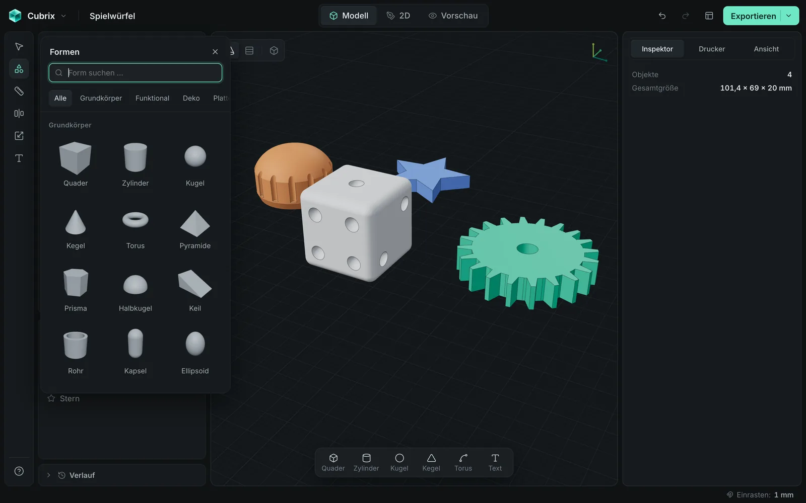
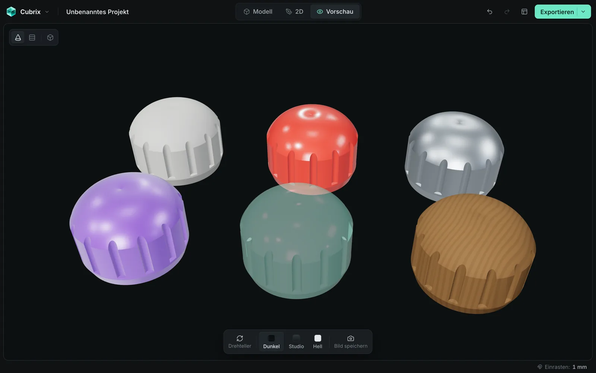
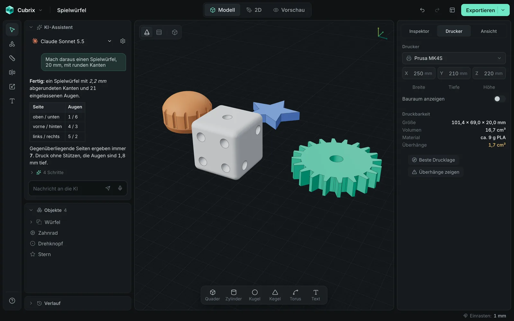

<div align="center">



# Cubrix

### CAD for 3D printing that you can just talk to.

Describe a part, drop in a picture, or model it yourself with real CAD tools.<br/>
Every step lands in your history, and every step stays editable.

[](https://github.com/NoahWiedemer/Cubrix/releases/latest)
[](https://github.com/NoahWiedemer/Cubrix/releases)


**[⬇ Download for macOS](https://github.com/NoahWiedemer/Cubrix/releases/latest)** (universal `.dmg`) &nbsp;·&nbsp; **[⬇ Download for Windows](https://github.com/NoahWiedemer/Cubrix/releases/latest)** (`.exe` or `.msi`)

<br/>



</div>

> The interface and the AI assistant currently speak German. An English UI is on the [roadmap](#roadmap).

## Why Cubrix

Most CAD tools make you learn the tool before you can make the part. Cubrix starts from the part. Say what you need, and the assistant plans it with real dimensions, builds it in one go and checks its own result. You can take over at any point, because the assistant uses the same commands as you: everything it does is a normal, parametric step you can change, undo or delete.

And it's made for printing: real solids, a build volume for your printer, overhang checks and clean exports.

## An AI that actually models



- **Talk to it.** "Build a box with a lid, 60 × 40 × 30 mm." Type it or say it with the microphone button.
- **Show it.** Drag pictures into the chat, paste them with ⌘V or attach them. It works out what it sees, derives proportions and rebuilds it.
- **It looks things up.** When it needs real-world dimensions, such as a board's hole spacing, it searches the web and links its sources under the answer.
- **It plans, builds, checks.** First a parts list with real measurements, then many parts in one step, then a self-check for floating parts, overlaps and anything outside the build volume.
- **One click undo.** Every run is one group in the history. Don't like the result? *Rückgängig* takes the whole run back.

## Real CAD tools

<table>
<tr>
<td width="50%"></td>
<td width="50%"></td>
</tr>
<tr>
<td><b>Shells, pockets and holes.</b> Hollow out a body with one value. Add through holes, counterbores, countersinks, thread core holes, pockets and bosses on any face.</td>
<td><b>Fillets on the edges you pick.</b> Round or chamfer all edges, or click single ones. Values that are too large snap to the largest size that really builds.</td>
</tr>
<tr>
<td></td>
<td></td>
</tr>
<tr>
<td><b>Sketches with true curves.</b> Rectangles, ellipses, slots, polygons and paths with arcs and splines. Give them a height or revolve them into vases, cups and knobs. Every shape keeps its own dimensions.</td>
<td><b>Text, threads and patterns.</b> Emboss or engrave text with your system fonts. Add real helical threads and matching thread holes. Repeat parts as rows, grids or circles, or mirror them.</td>
</tr>
</table>

Booleans are non-destructive: union, subtract and intersect keep their operands, so you can still edit, move or remove each one later.

## A workflow that stays out of your way



- **Shape library** with thumbnails: drag a shape onto the bed or onto another body.
- **Groups** as folders with one move handle, nested as deep as you like. ⌘-click drills in, level by level.
- **Multi-selection** moves, rotates and scales together, and the inspector shows shared values or *Gemischt* (mixed).
- **Branching history.** Click any step to go back; older branches stay recoverable.
- **Measure** distances and angles, align and distribute, snap to the grid and to other bodies, isolate, hide and lock.
- **Autosave and recovery**, so a crash doesn't cost you your work.

## Make it look like the real thing



Pick a color and a material per object: matte, glossy, metal, silk, transparent or wood. The Vorschau workspace gives you a clean render with a turntable, backgrounds and image export. Colors and material names go into your 3MF file.

## Ready to print



- Printer presets with their build volumes, or enter your own
- Printability summary with size, volume, estimated material and overhangs
- Best print orientation and a red overhang view
- Export to **STL, 3MF, OBJ and STEP**, and import STL, 3MF, STEP and SVG

**Automatic updates:** Cubrix checks GitHub Releases, shows you what's new, and installs signed updates in place.

## Bring your own key

The assistant works with your own **Anthropic** or **OpenAI** API key. Keys are stored locally on your machine and are only sent to the provider you choose. There's no Cubrix account and no Cubrix server. All the CAD tools work without a key.

## Use Cubrix from Claude Code / Codex

Cubrix can act as an MCP server, so a coding agent on your machine can model in the project you have open. Changes appear live in the viewport and land in the history, grouped as one run, so you can undo them.

1. In Cubrix, open **Settings → MCP** and switch on **Cubrix als Connector**. It is off by default, listens on `127.0.0.1` only (port 7331 or the next free one) and requires a bearer token.
2. Copy the ready-made setup from the same page. It contains your real token:

```bash
claude mcp add --transport http cubrix http://127.0.0.1:7331/mcp --header "Authorization: Bearer YOUR_TOKEN"
```

For Codex, add this to `~/.codex/config.toml` and set `CUBRIX_TOKEN` in the shell that starts Codex:

```toml
[mcp_servers.cubrix]
url = "http://127.0.0.1:7331/mcp"
bearer_token_env_var = "CUBRIX_TOKEN"
```

3. The first time a client connects, Cubrix asks whether it may control the project. Then try: *"Build a 60 x 40 mm tray with rounded corners in Cubrix."*

Agents get the same tools as the built-in assistant, plus `get_scene`, `save_project` and `export_model` (STL, 3MF, OBJ, STEP to an absolute path). Your agent can read and change the open project and write files through those tools, so treat the token like a password.

## Quickstart

1. [Download Cubrix](https://github.com/NoahWiedemer/Cubrix/releases/latest) and install it.  
   The builds aren't code-signed yet. On macOS, right-click the app and choose *Öffnen* the first time. On Windows, SmartScreen may ask you to confirm.
2. Add an API key in the AI panel, or skip it and start modeling.
3. Try: *"Bau ein ESP32 DevKit, maßhaltig und mit allen Details."*
4. Export and print.

## Keyboard shortcuts

| Key | Action | Key | Action |
| --- | --- | --- | --- |
| `W` `R` `S` | Move, rotate, scale | `⌘K` | Focus the AI chat |
| `L` | Shape library | `⌘Z` `⇧⌘Z` | Undo, redo |
| `T` | Text | `⌘D` | Duplicate |
| `M` | Measure | `⌘G` `⇧⌘G` | Group, ungroup |
| `A` | Align | `F` `⇧F` | Frame selection, frame all |
| `⇧E` | Pick edges | `H` `⇧H` `⌥H` | Hide, isolate, show all |
| `B` | Drop to bed | `⌘L` | Lock |
| `F2` | Rename | `?` | All shortcuts |

## Build from source

You need Node 20+ and stable Rust, plus the [Tauri prerequisites](https://tauri.app/start/prerequisites/) for your system.

```bash
git clone https://github.com/NoahWiedemer/Cubrix.git
cd Cubrix
npm install
npm run tauri dev      # desktop app
npm run dev            # browser only, http://localhost:1420
npm test               # tests
npm run tauri build    # installers; updater signing needs a key, see RELEASING.md
```

**Under the hood:** Tauri 2, React, TypeScript, three.js and OpenCascade (via replicad) in a web worker. Every action is a registered command, so buttons, shortcuts and the AI all share the same code paths and the same history.

## Roadmap

- English interface and assistant
- Loft and sweep
- Fillets on hole edges
- Code-signed builds for macOS and Windows
- Sharing models with others

## Contributing

Issues and ideas are welcome. Please open an issue before a larger pull request, so we can agree on the approach. Run `npm test` before you submit.

<div align="center">
<br/>
Made by <a href="https://codana.de">Codana</a>
</div>
