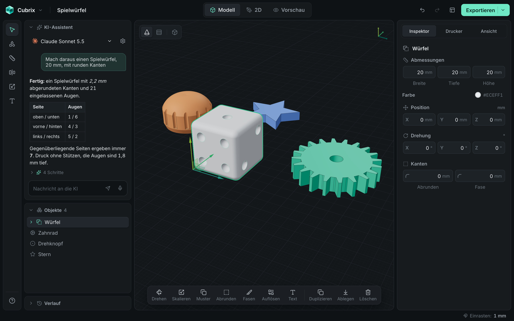

# Cubrix

CAD für den 3D-Druck – einfach, ruhig, auf Deutsch. Desktop-App (macOS, später Windows) auf Basis von Tauri 2, React, three.js und dem OpenCascade-Kern (replicad, WASM).



## Download

Fertige Versionen für macOS (`.dmg`) und Windows (`.exe`/`.msi`):
**https://github.com/NoahWiedemer/modelonio/releases/latest**

Hinweis: Die Builds sind noch nicht signiert – auf dem Mac beim ersten Start Rechtsklick → „Öffnen“.
Wie Releases entstehen, steht in [RELEASING.md](RELEASING.md).

## Starten

```bash
npm install
npm run tauri dev      # Desktop-App
npm run dev            # nur im Browser: http://localhost:1420 (?beispiel lädt das Beispielprojekt)
npm run build          # Frontend-Build (Typecheck + Vite)
npm run tauri build    # installierbare App (.app/.dmg)
```

Voraussetzungen: Node 20+, Rust (stable).

## Etappe 1 – Funktionsumfang

- Grundkörper: Quader, Zylinder, Kugel, Kegel, Torus
- Auswählen (⇧-Klick für Mehrfachauswahl), Verschieben/Drehen mit Gizmo oder Zahlenfeldern (Label ziehen zum Ändern), Einrasten
- Maße mit Proportionssperre, Kanten abrunden, Duplizieren, Löschen, Ein-/Ausblenden, „Aufs Bett“
- Boolesche Operationen: Vereinen, Abziehen, Schnittmenge (und wieder auflösen)
- Verlauf wie in Photoshop: jeder Schritt anklickbar, frühere Zweige bleiben wiederherstellbar, ⌘Z / ⇧⌘Z
- Druckprüfung (geschlossen, auf dem Bett, im Bauraum des Snapmaker Original 125³ mm)
- Export als STL, 3MF, OBJ und STEP; Projekte als `.cubrix` (JSON) speichern/öffnen (ältere `.albedo`- und `.modelonio`-Dateien werden weiterhin geöffnet)

## Architektur

- `src/core/document.ts` – das Dokument: serialisierbare JSON-Featureliste
- `src/core/commands.ts` – zentrale Befehls-Registry (ID, typisierte Parameter, Beschreibung, Ausführung). Buttons, Tastenkürzel und später KI-Chat/MCP rufen dieselben Befehle auf; `toToolDefinition()` liefert JSON-Schema-Tooldefinitionen.
- `src/core/commandDefs.ts` – alle Befehle (`primitive.box`, `object.transform`, `boolean.subtract`, `export.stl`, …)
- `src/core/store.ts` – Verlaufsbaum aus Dokument-Snapshots; Einträge haben `source: 'user' | 'ai'`
- `src/cad/worker.ts` – CAD-Kern im Web Worker (Meshing, STL/3MF-Export)
- `src/components/` – Oberfläche

In der Entwicklerkonsole: `cubrix.execute("primitive.box", { width: 40 })`, `cubrix.commands()`.

Hinweis: Ordner, Repository und Rust-Crate heißen aus technischen Gründen noch `modelonio`.
